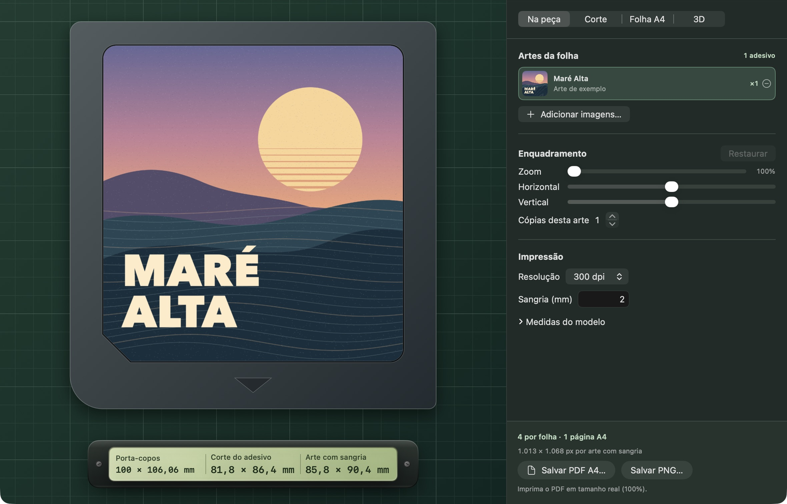
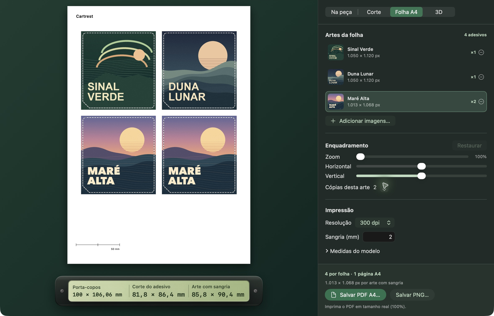
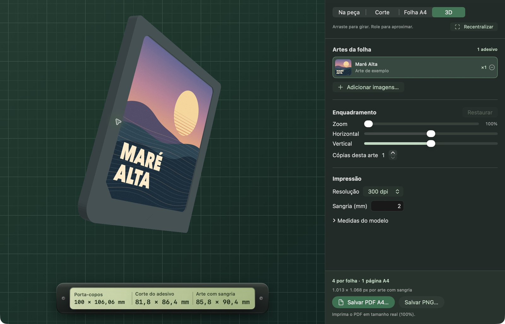

<p align="center">
  
</p>

<h1 align="center">Cartrest</h1>

<p align="center">Porta-copos de cartucho DS e um editor nativo de adesivos para macOS.</p>

<p align="center">
  <strong><a href="https://github.com/RafaelCasamaximo/cartrest/releases/latest">Baixar para macOS</a></strong>
  · macOS 14 ou posterior · Apple Silicon e Intel
</p>



Cartrest reúne um modelo 3D para imprimir em PLA e um editor em SwiftUI para montar o adesivo vinílico que encaixa no rebaixo da peça. O editor transforma suas capas, fotos ou desenhos em um **PDF A4 em escala real**, com sangria, linha de corte e régua de conferência.

## Instalar no macOS

1. Baixe o arquivo `Cartrest-1.0.0-macOS-universal.dmg`. [GitHub Releases](https://github.com/RafaelCasamaximo/cartrest/releases/latest)
2. Abra o DMG e arraste **Cartrest** para **Aplicativos**.
3. Ejete a imagem de disco e abra o Cartrest pelo Finder.

O aplicativo deste pacote tem assinatura ad hoc. A distribuição notarizada usa uma identidade Developer ID e o serviço de notarização da Apple. [Distribuição no macOS](https://developer.apple.com/macos/distribution/)

## Montar a folha de adesivos

1. Em **Adicionar imagens…**, selecione uma ou várias artes.
2. Escolha cada imagem para ajustar zoom, posição e quantidade de cópias.
3. Abra **Folha A4** para conferir a distribuição. No tamanho padrão, cabem quatro adesivos por folha.
4. Salve o **PDF A4** para imprimir a folha ou o **PNG** para exportar a arte selecionada.



Imprima o primeiro teste em papel comum, em **Tamanho real (100%)**. A régua do PDF deve medir **50 mm**. Confira o encaixe antes de cortar o vinil. Sobre PLA cinza escuro, vinil branco imprimível ajuda a preservar as cores da arte.

## Girar o cartucho em 3D

O modo **3D** fica ao lado de **Na peça**, **Corte** e **Folha A4**. Arraste a prévia para orbitar o cartucho, role para ajustar o zoom e clique em **Recentralizar** para voltar à vista inicial. A peça usa a malha do STL e mostra a arte selecionada com o recorte do editor.



## Imprimir o porta-copos

| Parte | Medida padrão |
| --- | --- |
| Porta-copos | 100 × 106,06 × 6 mm |
| Rebaixo | 82,6 × 87,2 × 0,6 mm |
| Corte do adesivo | 81,8 × 86,4 mm |
| Arte com 2 mm de sangria | 85,8 × 90,4 mm |

Importe o STL no fatiador em milímetros e a 100%, com a base plana na mesa. Para a Creality K2 SE com bico de 0,4 mm, o preset de PLA a 0,20 mm é um ponto de partida. O cupom reduz o custo de testar a borda e o encaixe. [Porta-copos STL](modelo/cartrest-ds-100mm.stl) · [Cupom de encaixe STL](modelo/cartrest-cupom-encaixe.stl) · [Guia de fatiamento e referências](modelo/LEIA-ME.md)

## Desenvolver e gerar um release

Com as Command Line Tools do Xcode ou o Xcode instalados, execute na raiz do projeto.

```sh
./macOS/compilar.sh
```

O build local gera `Cartrest.app`. O empacotador produz o instalador universal com checksum SHA-256 e usa Python 3 com `venv` e `pip` para preparar as dependências de empacotamento.

```sh
./macOS/empacotar.sh 1.0.0
```

| Caminho | Conteúdo |
| --- | --- |
| `macOS/Cartrest/` | Editor SwiftUI, visualização 3D, geometria e exportação em Core Graphics |
| `macOS/Recursos/` | Arte de exemplo incluída no aplicativo |
| `macOS/Release/` | Recursos e configuração do instalador |
| `modelo/` | STLs e gerador paramétrico com as cotas do adesivo |
| `docs/imagens/` | Capturas do aplicativo |
| `dist/` | DMG e checksum gerados no build de distribuição |

Para empacotar com assinatura de distribuição, defina `CARTREST_CODESIGN_IDENTITY` com a identidade Developer ID Application. Defina também `CARTREST_NOTARY_PROFILE` com o perfil do `notarytool` no Chaveiro para notarizar o DMG. [Empacotamento no macOS](https://developer.apple.com/documentation/xcode/packaging-mac-software-for-distribution)

O editor lê o mesmo `modelo/dimensoes.json` que acompanha os STLs, e a prévia A4 usa as mesmas posições do exportador. [Aparência do Cartrest](DESIGN.md) · [Origem do nome](NOMES.md)
