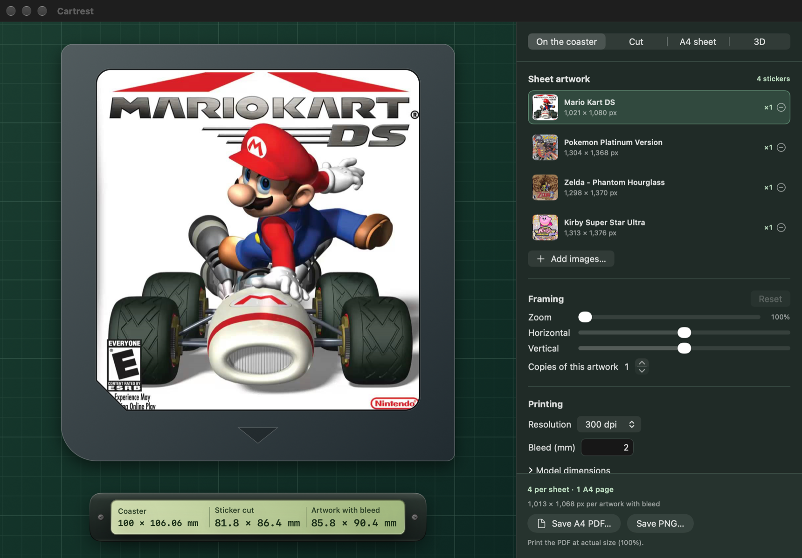
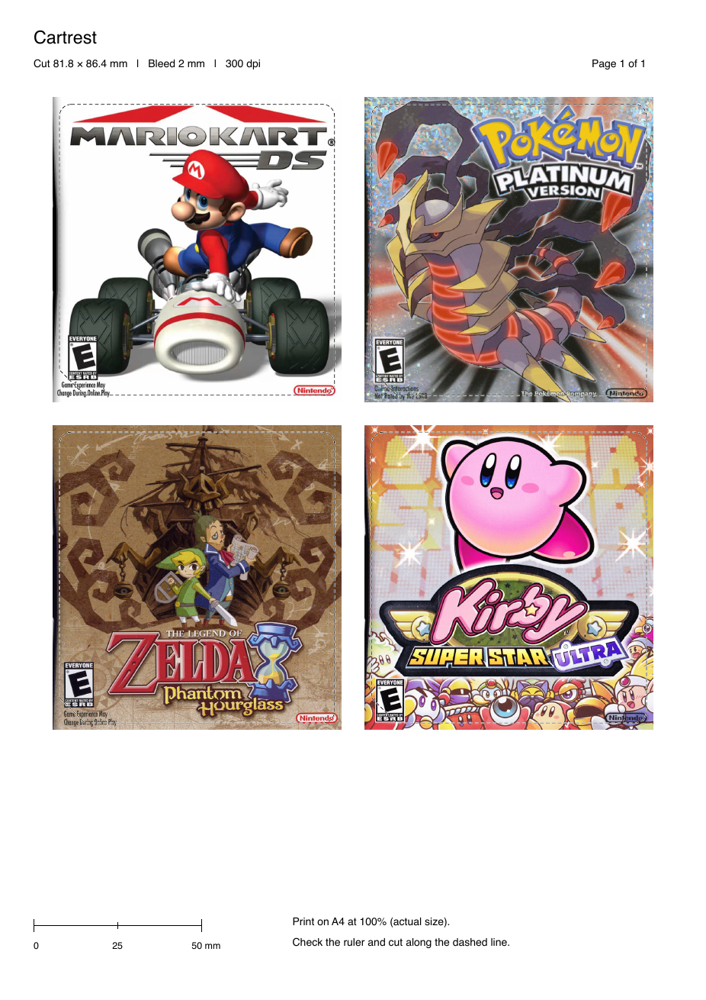
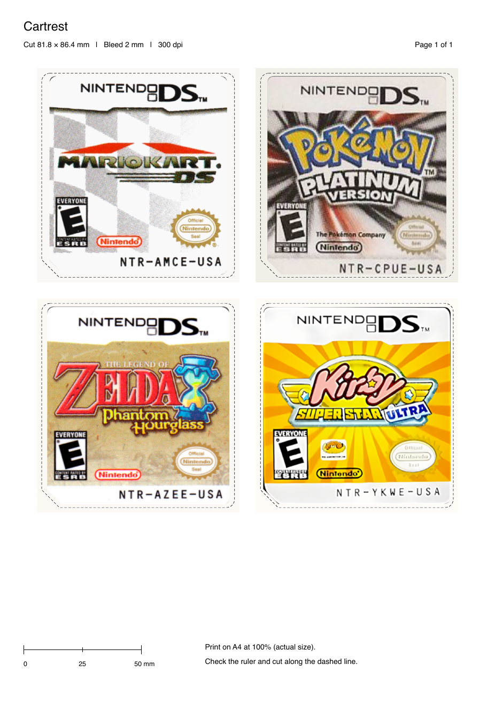
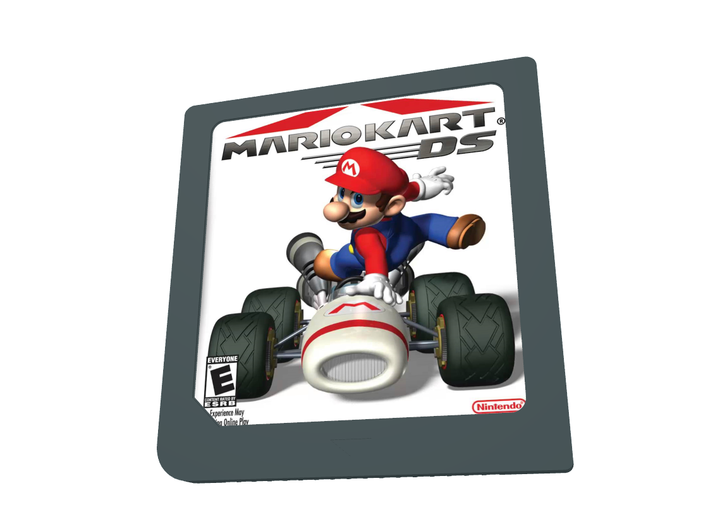
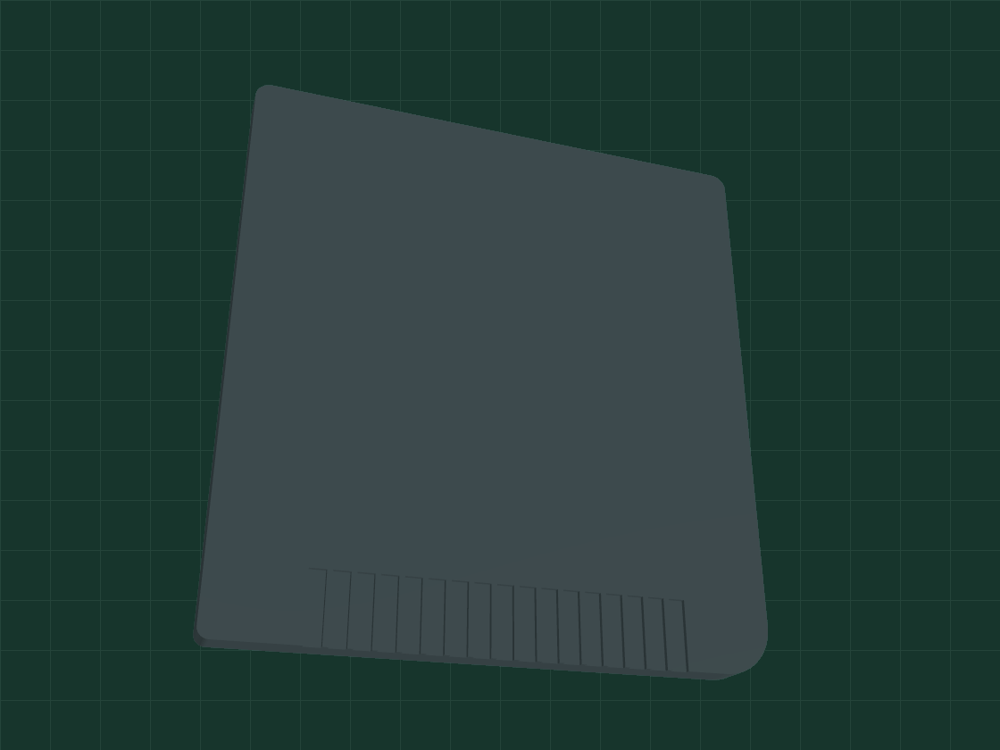

<p align="center">
  
</p>

<h1 align="center">Cartrest</h1>

<p align="center">A Nintendo DS–inspired coaster and a native macOS editor for print-ready vinyl labels.</p>

<p align="center">
  <strong><a href="https://github.com/RafaelCasamaximo/cartrest/releases/latest">Download for macOS</a></strong>
  · macOS 14 or later · Apple Silicon and Intel
</p>



Cartrest pairs a 3D-printable coaster with a SwiftUI editor for labels that fit its recess. Crop artwork on the coaster, arrange copies on an A4 sheet, and export a **full-scale PDF** with bleed, a vector cut line, and a 50 mm reference ruler.

## Install on macOS

1. Download `Cartrest-1.1.2-macOS-universal.dmg`. [GitHub Releases](https://github.com/RafaelCasamaximo/cartrest/releases/latest)
2. Open the disk image and drag **Cartrest** to **Applications**.
3. Eject the disk image and open Cartrest from Finder.

The app in this release uses ad hoc signing. To verify the download, save the DMG and its `.sha256` file in the same folder and run the following command from that folder.

```sh
shasum -a 256 -c Cartrest-1.1.2-macOS-universal.dmg.sha256
```

## Lay out a sticker sheet

1. Select **Add images…** and choose one or more images.
2. Select each image to adjust its zoom, position, and copy count. **On the coaster** shows the artwork inside the recess, and **Cut** shows its print boundary.
3. Open **A4 sheet** to check the layout. At the default size, four labels fit on a page.
4. Select **Save A4 PDF…** to print the sheet or **Save PNG…** to export the selected artwork.

The examples use the North American retail artwork for Mario Kart DS, Pokémon Platinum Version, The Legend of Zelda: Phantom Hourglass, and Kirby Super Star Ultra. Each A4 sheet fits one of every game. [Source scans and importable artwork](examples/README.md) · [Box cover PDF](print/cartrest-example-a4.pdf) · [Cartridge label PDF](print/cartrest-cartridge-labels-a4.pdf)

| Box covers | Cartridge labels |
| --- | --- |
|  |  |

Print a test on plain paper at **Actual Size (100%)**, measure the 50 mm ruler, and check the cut against the recess before printing on vinyl. White printable vinyl helps preserve artwork colors over dark gray PLA.

## Explore the cartridge in 3D

Select **3D** and drag to orbit the cartridge. Scroll to zoom, then choose **Recenter** to restore the starting view. The preview uses the STL mesh, applies the selected artwork to the front recess, and shows the 17 recessed contact channels on the back.

| Front | Back |
| --- | --- |
|  |  |

## Print the coaster

| Part | Default dimensions |
| --- | --- |
| Coaster | 100 × 106.06 × 6 mm |
| Recess | 82.6 × 87.2 × 0.6 mm |
| Cut label | 81.8 × 86.4 mm |
| Artwork with 2 mm bleed | 85.8 × 90.4 mm |

Import the STL in millimeters at 100% scale, with the label face up. On the Creality K2 SE with a 0.4 mm nozzle, the 0.20 mm PLA preset is a starting point. Print the small fit test to check the recess and label clearance before committing to the full coaster. [Coaster STL](model/cartrest-ds-100mm.stl) · [Fit-test STL](model/cartrest-fit-test.stl) · [Model and slicing guide](model/README.md)

## Build from source

Install Xcode or the Xcode Command Line Tools and run the build from the project root. It produces `Cartrest.app`.

```sh
./macOS/build.sh
```

The release packager builds a universal app and writes a DMG and SHA-256 checksum to `dist/`. It uses Python 3 with `venv` and `pip` to install the pinned packaging dependencies.

```sh
./macOS/package-release.sh
```

For distribution signing, set `CARTREST_CODESIGN_IDENTITY` to a Developer ID Application identity. Set `CARTREST_NOTARY_PROFILE` to a stored Keychain profile for `notarytool` to submit and staple the disk image. [Packaging for macOS distribution](https://developer.apple.com/documentation/xcode/packaging-mac-software-for-distribution)

| Path | Contents |
| --- | --- |
| `macOS/Cartrest/` | SwiftUI editor, 3D preview, geometry, and Core Graphics export |
| `macOS/Release/` | Disk image background and packaging settings |
| `model/` | Coaster and fit-test meshes, parametric generator, and shared dimensions |
| `design/icon/` | Editable SVG, Icon Composer project, and rendered icon |
| `examples/` | Original retail scans, importable artwork, and source links |
| `print/` | Full-size A4 sheets for box covers and cartridge labels |
| `docs/images/` | App screenshots |

The editor and model share `dimensions.json`, and the A4 preview uses the same placement calculations as the PDF export. Command-line builds bundle a static `.icns` made from the Liquid Glass export. [Icon Composer project](design/icon/Cartrest.icon) · [SVG source](design/icon/Cartrest.svg) · [Icon editing and export](design/icon/README.md) · [Design notes](DESIGN.md)
