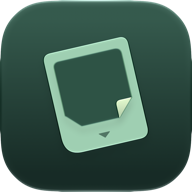
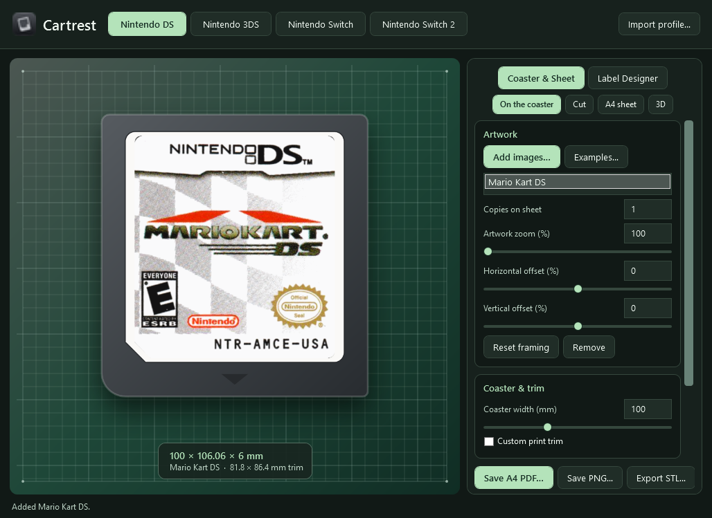
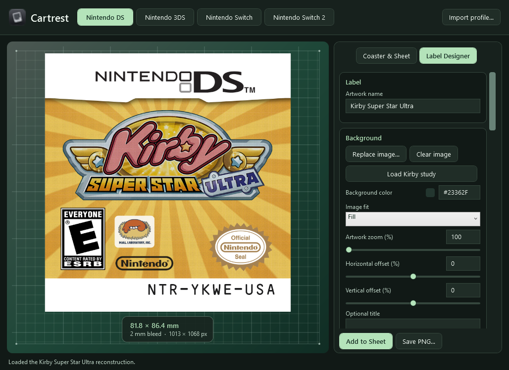
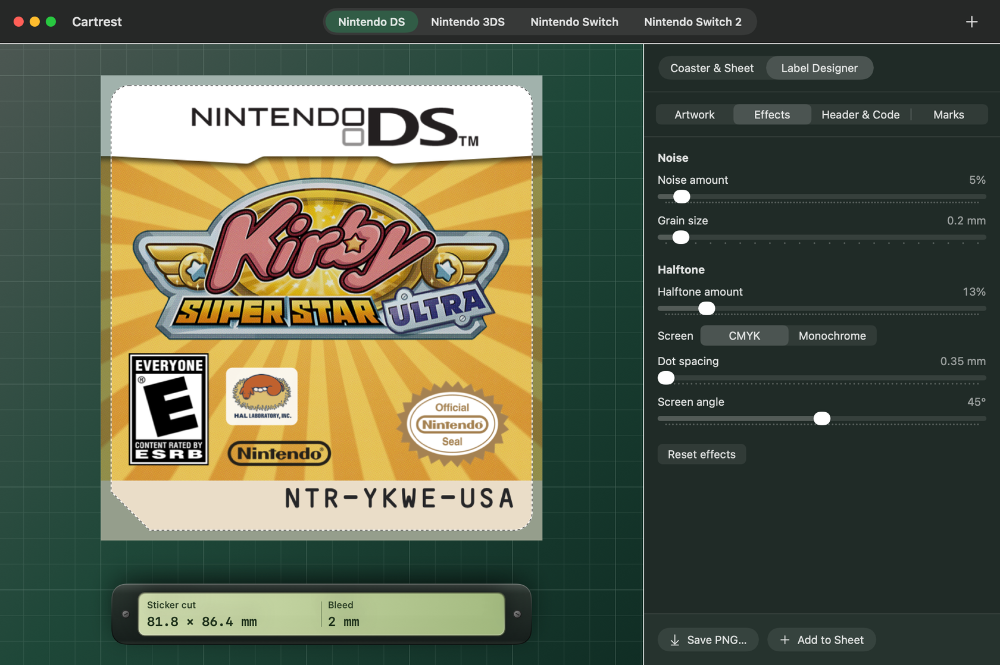
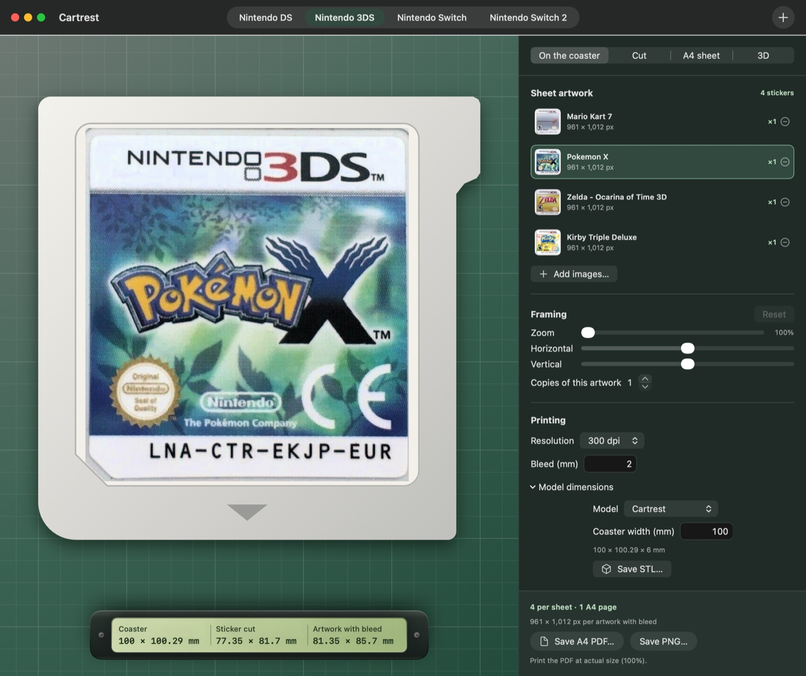
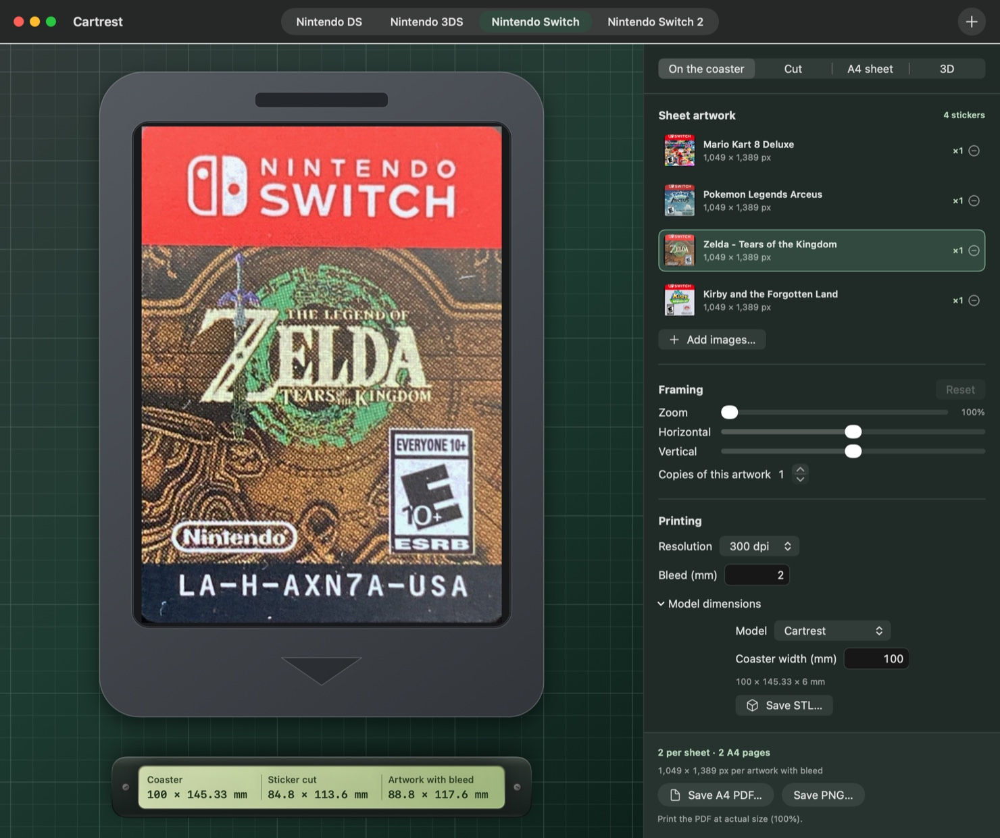
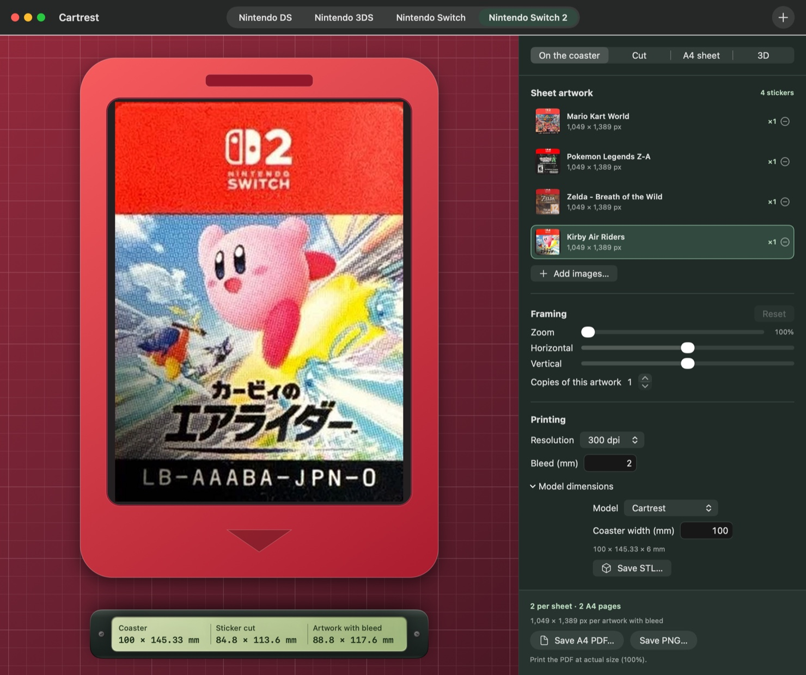
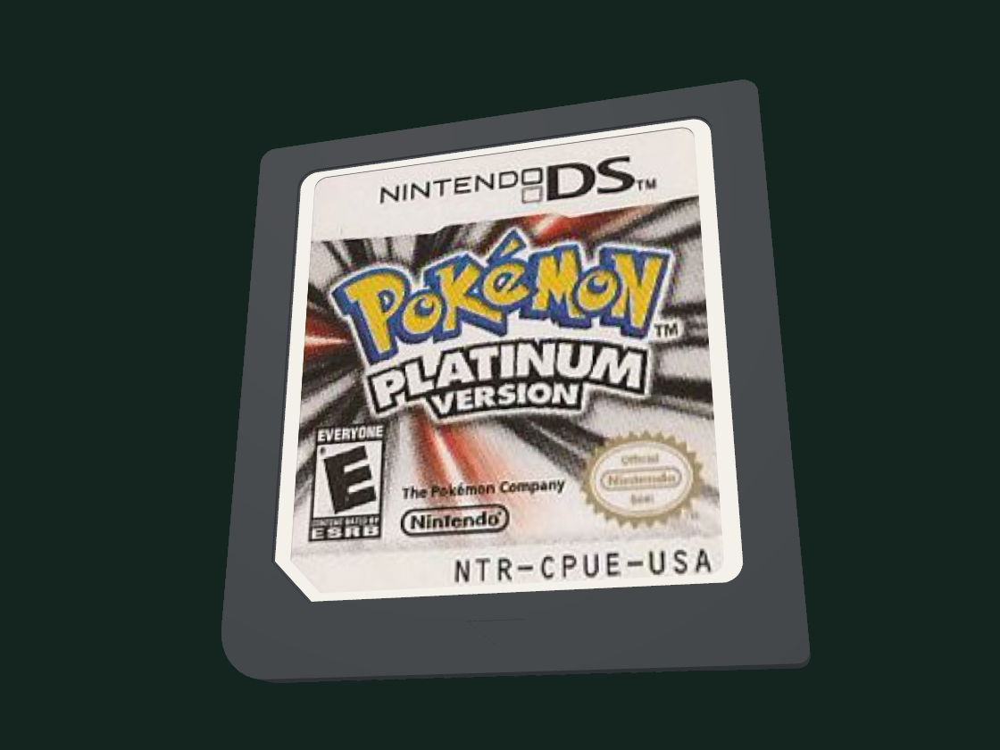
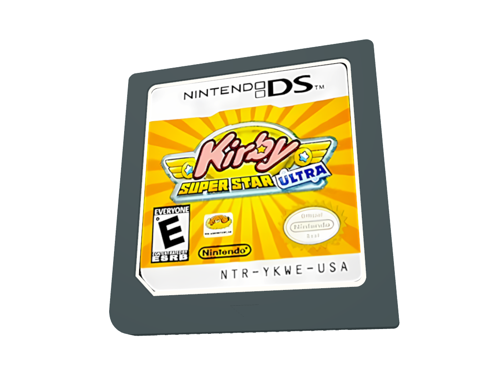

<p align="center">
  
</p>

<h1 align="center">Cartrest</h1>

<p align="center">3D-printable cartridge coasters and native macOS and Windows editors for vinyl labels.</p>

<p align="center">
  <strong><a href="https://github.com/RafaelCasamaximo/cartrest/releases/latest">Download for macOS</a></strong>
  · macOS 14 or later · Apple Silicon and Intel
  <br>
  <strong><a href="https://github.com/RafaelCasamaximo/cartrest/releases/tag/v1.4.0-beta.1">Download the Windows beta</a></strong>
  · Windows 11 x64
</p>


Cartrest pairs four 3D-printable cartridge models with native SwiftUI and WPF editors for labels that fit their recesses. Choose **Nintendo DS**, **Nintendo 3DS**, **Nintendo Switch**, or **Nintendo Switch 2** to preview the matching model, arrange copies on an A4 sheet, and export a **full-scale PDF** with bleed, a vector cut line, and a 50 mm reference ruler.

## Install on macOS

1. Download `Cartrest-1.3.0-macOS-universal.dmg`. [GitHub Releases](https://github.com/RafaelCasamaximo/cartrest/releases/latest)
2. Open the disk image and drag **Cartrest** to **Applications**.
3. Eject the disk image and open Cartrest from Finder.

The app in this release uses ad hoc signing. To verify the download, save the DMG and its `.sha256` file in the same folder and run the following command from that folder.

```sh
shasum -a 256 -c Cartrest-1.3.0-macOS-universal.dmg.sha256
```

## Install on Windows

Download `Cartrest-1.4.0-beta.1-Windows-x64-Setup.exe`, run the setup wizard, and open **Cartrest** from the Start menu. Setup includes the .NET runtime and installs for your Windows account. The beta installer is unsigned. [Windows beta release](https://github.com/RafaelCasamaximo/cartrest/releases/tag/v1.4.0-beta.1)

Compare the SHA-256 shown below with the value in the accompanying `.sha256` file.

```powershell
Get-FileHash .\Cartrest-1.4.0-beta.1-Windows-x64-Setup.exe -Algorithm SHA256
```

The Windows beta includes all four stock console tabs, custom JSON profiles, a rotatable 3D proof, parametric STL export, A4 and PNG export, and the Label Designer. Use **Examples…** for the four retail labels included with each console. In **Nintendo DS → Label Designer**, choose **Load Kirby study** to open the reconstruction with the original-style stepped header and code band. [Windows build and setup guide](windows/README.md)

| Coaster & Sheet on Windows | Kirby study in Windows Label Designer |
| --- | --- |
| [](docs/images/windows-coaster.png) | [](docs/images/windows-label-designer.png) |

## Lay out a sticker sheet

1. Choose a console in the toolbar. Each tab keeps its own artwork, framing, copy counts, and print settings for the session.
2. Select **Add images…** and choose one or more images.
3. Select each image to adjust its zoom, position, and copy count. **On the coaster** shows the artwork inside the recess, and **Cut** shows its print boundary.
4. Open **A4 sheet** to check the layout and page count. The larger Switch labels fit two per A4 sheet at the default size and bleed.
5. Select **Save A4 PDF…** to print the sheet or **Save PNG…** to export the selected artwork.

Print a test on plain paper at **Actual Size (100%)**, measure the 50 mm ruler, and check the cut against the recess before printing on vinyl. White printable vinyl helps preserve artwork colors over dark gray PLA.

## Design a cartridge label

Open **Label Designer** at the top of the right inspector. The workspace has its own cutting-mat preview for the selected console. Import your art, add grain or a CMYK or monochrome halftone in **Effects**, and choose the console's masthead and code alignment in **Header & Code**. The rating, publisher, studio, and seal each have placement and sizing controls. The catalog includes nine layouts, 57 rating graphics across eight systems, 26 publisher and studio graphics, and three seals or conformity marks.

Use **Add to Sheet** to place the result with your other artwork and open the A4 preview. **Save PNG…** exports it with bleed and resolution metadata. The cut dimensions follow the selected coaster width. [Designer guide](design/labels/README.md) · [Cartridge research and original sources](docs/cartridge-label-references.md)



### Cartridge reconstruction

The North American **Kirby Super Star Ultra** sticker was rebuilt in Cartrest from a separate title graphic, a measured sunburst, and era-specific marks. The retail photograph sits beside the reconstruction with its white bands and shadowed header on the Nintendo DS coaster model.


[Build settings and sources](examples/reconstructions/kirby-super-star-ultra/README.md) · [Importable background](examples/reconstructions/kirby-super-star-ultra/background.png) · [Finished label PNG](examples/reconstructions/kirby-super-star-ultra/label.png) · [Two-copy A4 sheet](print/kirby-super-star-ultra-reconstructed-a4.pdf)

## Game artwork and print examples

Each console set includes four retail cartridge labels, one from each series. Open the matching tab to import the PNGs, or download the full-size A4 sheets for a 100 mm coaster. [Import-ready PNGs and sources](examples/README.md) · [Print guide](print/README.md)

| Console | Mario | Pokémon | Zelda | Kirby | A4 |
| --- | --- | --- | --- | --- | --- |
| Nintendo DS | Mario Kart DS | Pokémon Platinum Version | Phantom Hourglass | Super Star Ultra | [Cartridge labels](print/cartrest-cartridge-labels-a4.pdf) · [Box covers](print/cartrest-example-a4.pdf) |
| Nintendo 3DS | Mario Kart 7 | Pokémon X | Ocarina of Time 3D | Triple Deluxe | [Cartridge labels](print/cartrest-3ds-cartridge-labels-a4.pdf) |
| Nintendo Switch | Mario Kart 8 Deluxe | Pokémon Legends: Arceus | Tears of the Kingdom | Kirby and the Forgotten Land | [Cartridge labels](print/cartrest-switch-cartridge-labels-a4.pdf) |
| Nintendo Switch 2 | Mario Kart World | Pokémon Legends: Z-A¹ | Breath of the Wild¹ | Kirby Air Riders | [Cartridge labels](print/cartrest-switch2-cartridge-labels-a4.pdf) |

¹ Nintendo Switch 2 Edition.

| Nintendo 3DS | Nintendo Switch | Nintendo Switch 2 |
| --- | --- | --- |
| [](docs/images/editor-3ds.jpg) | [](docs/images/editor-switch.jpg) | [](docs/images/editor-switch2.jpg) |

## Explore the cartridge in 3D

Select **3D** and drag to orbit the cartridge. Scroll to zoom, then choose **Recenter** to restore the starting view. Each tab previews the same solid it exports for printing, with the matching shell color and the selected artwork inside the recess. The DS examples below use the original cartridge labels.

| Pokémon Platinum Version | Kirby Super Star Ultra |
| --- | --- |
|  |  |

<p align="center">
  
</p>

## Print the coaster

| Console | Coaster | Cut label | Files |
| --- | --- | --- | --- |
| Nintendo DS | 100 × 106.06 × 6 mm | 81.8 × 86.4 mm | [STL](model/cartrest-ds-100mm.stl) · [Fit test](model/cartrest-fit-test.stl) |
| Nintendo 3DS | 100 × 100.29 × 6 mm | 77.35 × 81.70 mm | [STL](model/3ds/cartrest-3ds-100mm.stl) · [Fit test](model/3ds/cartrest-fit-test.stl) |
| Nintendo Switch | 100 × 145.33 × 6 mm | 84.8 × 113.6 mm | [STL](model/switch/cartrest-switch-100mm.stl) · [Fit test](model/switch/cartrest-fit-test.stl) |
| Nintendo Switch 2 | 100 × 145.33 × 6 mm | 84.8 × 113.6 mm | [STL](model/switch2/cartrest-switch2-100mm.stl) · [Fit test](model/switch2/cartrest-fit-test.stl) |

For a custom size, set **Coaster width (mm)** under **Model dimensions**, then select **Save STL…**. Height, thickness, and the label cut scale with the width. Export the labels from the same tab so they fit the saved model.

Import the STL in millimeters at 100% scale, with the label face up. On the Creality K2 SE with a 0.4 mm nozzle, the 0.20 mm PLA preset is a starting point. Print the small fit test to check the recess and label clearance before committing to the full coaster. [Model and slicing guide](model/README.md)

## Add a console or a variation

1. Copy a profile such as [ds.json](consoles/ds.json) and choose a unique ID and tab name.
2. Set the cutting mat palette, cartridge dimensions, and sticker outline. Adjust the construction instructions to define the body, label recess, and rear contact details.
3. Choose **File → Import Console Profile…** or click the toolbar **+**. Inspect the result in **3D** and export a test STL before sharing the JSON or opening a pull request.

The palette can set the tint color and strength, gradient direction, grid opacity, and shell colors for each tab. [Profile authoring guide](consoles/README.md#create-a-profile) · [Palette settings](consoles/README.md#palette) · [Construction instructions](consoles/README.md#construction-instructions) · [JSON Schema](consoles/profile.schema.json)

## Build from source

Install Xcode or the Xcode Command Line Tools and run the build from the project root. It produces `Cartrest.app`.

```sh
./macOS/build.sh
```

The release packager builds a universal app and writes a DMG and SHA-256 checksum to `dist/`. It uses Python 3 with `venv` and `pip` to install the pinned packaging dependencies.

```sh
./macOS/package-release.sh
```

For distribution signing, set `CARTREST_CODESIGN_IDENTITY` to a Developer ID Application identity. Set `CARTREST_NOTARY_PROFILE` to a stored Keychain profile for `notarytool` to submit and staple the disk image. [Packaging for macOS distribution](https://developer.apple.com/documentation/xcode/packaging-mac-software-for-distribution)

| Path | Contents |
| --- | --- |
| `macOS/Cartrest/` | SwiftUI editor, 3D preview, geometry, and Core Graphics export |
| `macOS/Release/` | Disk image background and packaging settings |
| `consoles/` | Console profiles, construction recipes, and a contributor guide |
| `model/` | Downloadable meshes, fit tests, and the command-line generator |
| `windows/` | Native Windows app, C# print and mesh engine, and x64 installer |
| `design/icon/` | Editable SVG, Icon Composer project, and rendered icon |
| `design/labels/` | Source-linked cartridge mastheads, ratings, logos, and designer templates |
| `examples/` | Original retail scans, importable artwork, and source links |
| `print/` | Full-size A4 sheets for box covers and cartridge labels |
| `docs/images/` | App screenshots |

The A4 preview uses the same placement calculations as the PDF export. The app and the command-line model generator read the same console profiles. Command-line builds bundle a static `.icns` made from the Liquid Glass export. [Icon Composer project](design/icon/Cartrest.icon) · [SVG source](design/icon/Cartrest.svg) · [Icon editing and export](design/icon/README.md) · [Design notes](DESIGN.md)

## Contributing and licenses

Import the [Nintendo DS Graphite example](examples/profiles/ds-graphite.json) to try a custom palette, then follow the [profile guide](consoles/README.md) to define a new console. The [contribution guide](CONTRIBUTING.md) covers validation and platform builds.

The application code and stock profile JSON use the [MIT License](LICENSE). The original STL files use [CC BY-NC 4.0](model/LICENSE.md). [Licensing and asset credits](LICENSING.md)

## Acknowledgments

Thanks to **AF_Inventions** for sharing *Fun Cartridge* and its Nintendo DS coaster design, and to **magu** for publishing the dummy cartridge used as a reference for the original proportions. [Fun Cartridge on Cults](https://cults3d.com/en/3d-model/game/fun-cartridge-keychain-coasters-tray-more) · [Nintendo DS dummy cartridge on Cults](https://cults3d.com/en/3d-model/gadget/nintendo-ds-dummy-cartridge-ds-dsi-3ds-2ds)

Thanks to **LaunchBox Games Database**, **VGCollect**, **No-Intro Wiki**, and the photographers who shared the retail artwork and cartridge photos used in the examples. [Sources by game](examples/README.md)
