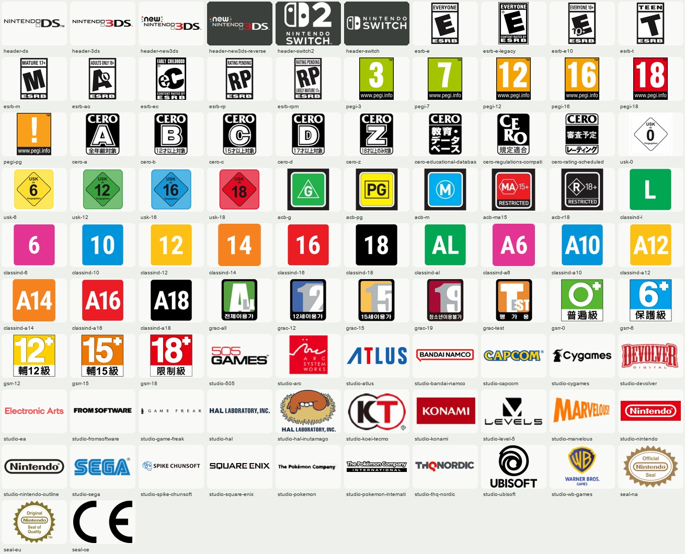

# Cartridge label research

Cartrest's label templates describe the front sticker and scale to the vinyl cut in the console profile. This survey compares photographed or scanned retail fronts. The reusable marks come from published artwork and selected retail photos. [Import-ready reference examples](../examples/README.md) · [Designer asset catalog](../design/labels/catalog.json)

## Parts of the sticker

| Part | What the images show | Designer control |
| --- | --- | --- |
| Masthead | DS and standard 3DS use light fields with dark lettering in the sampled fronts. The `3` in the 3DS mark is red. The photographed KTR card reverses the lettering on black. Switch uses a horizontal white lockup on red, and Switch 2 uses a stacked lockup. | Template, header band color, logo size, custom logo, and shadow, flat or hidden style |
| Header seam | The DS edge has sloped shoulders and a stepped center. *Mario Kart DS* has a pronounced shadow and *Kirby Super Star Ultra* has a light edge. The sampled 3DS headers use a straight seam. | Shadow follows the template's edge. Flat keeps the edge without shading. |
| Artwork field | The game title and illustration sit between the masthead and footer. Titles leave different areas for logos and ratings. | Imported background, backing color, fill or fit, zoom, pan, and optional title |
| Rating and logos | Ratings appear on either side of the artwork. Some fronts omit the age emblem even when the same release carries a rating on its box. | Independent rating, publisher, studio, and seal slots with position, scale, and backing |
| Code footer | DS and standard 3DS examples have dark identifiers on a light area. The KTR, Switch, and Switch 2 examples have light identifiers on dark. | Editable code, band color, code color, size, and horizontal alignment |

### DS and 3DS measurements

- Nintendo of America Design Services' `NTR-62-0147-001D` drawing lists the original DS trim as 26.3 × 28.5 mm. Cartrest traces the lower edge of its header, including the four small Bézier transitions at the shoulders. The seam runs about 17.4% to 19.3% down the original trim. The wordmark is about 70.1% of trim width and its center sits at 53.2% across. Both NTR and TWL use this starting geometry and a right-aligned OCR-B code. The drawing specifies a 5 pt code at the original cartridge size. Cartrest sizes it with the coaster. [Nintendo DS production drawing](https://repo.mariocube.com/Marketing/Nintendo%20Design%20Files/AIfiles/DS_L_Card_Label/DS_L_CardLabel.pdf) · [OCR-B credits](../design/labels/fonts/NOTICE.md)
- The straight CTR seam sits approximately 18–19% down the sticker in the four 3DS scans below. After cropping to the label, their dark wordmarks and red `3` occupy roughly 79% of the trim width. Cartrest uses an 18.5% band and a wordmark centered at 52.7% across. [Mario Kart 7 scan](https://gamesdb.launchbox-app.com/games/images/12287-mario-kart-7) · [Kirby: Triple Deluxe scan](https://gamesdb.launchbox-app.com/games/images/19866-kirby-triple-deluxe) · [Pokémon X scan](https://gamesdb.launchbox-app.com/games/images/17513-pokmon-x) · [Ocarina of Time 3D scan](https://gamesdb.launchbox-app.com/games/images/12252-the-legend-of-zelda-ocarina-of-time-3d)
- The European *Xenoblade Chronicles 3D* card has a taller straight band, black stock in the header and footer, and light lettering around the red `3`. The KTR preset uses a 26% band and a light-lettering version of the published New Nintendo 3DS wordmark. A lighter custom band uses the dark-lettering version. [Cartridge scan](https://vgcollect.com/images/cart-art/78341.jpg) · [Cartridge record](https://vgcollect.com/item/78341) · [Published wordmark](https://commons.wikimedia.org/wiki/File:New_Nintendo_3DS_logo.svg)

The Switch and Switch 2 presets use 23.1% and 25.8% header bands, respectively. The footers across the layouts use about 10–11% of cut height. The presets scale their proportions to the cut configured for each coaster. [Nintendo's guide to game card publisher marks](https://en-americas-support.nintendo.com/app/answers/detail/a_id/236/p/50)

## Observed game cards

The identifier below refers to the visible front label. The rear shell number, ink-stamped production code, and packaging code describe other parts of the release.

| Family and sample | Front identifier | Observed marks | Image or record |
| --- | --- | --- | --- |
| DS · Mario Kart DS, North America | `NTR-AMCE-USA` | ESRB lower left, Nintendo oval and gold seal above the code, stepped dark header seam. | [Front scan](https://gamesdb.launchbox-app.com/games/images/6545-mario-kart-ds) |
| DS · Pokémon Platinum Version, North America | `NTR-CPUE-USA` | ESRB lower left, The Pokémon Company and Nintendo wordmarks, gold seal at lower right. | [Front scan](https://gamesdb.launchbox-app.com/games/images/2245-pokmon-platinum-version) |
| DS · Kirby Super Star Ultra, North America | `NTR-YKWE-USA` | ESRB lower left, Nintendo and gold seal below the title, light header edge. | [Front scan](https://gamesdb.launchbox-app.com/games/images/10842-kirby-super-star-ultra) |
| DS · Pokémon Black Version, North America | `TWL-IRBO-USA` | The DSi-enhanced release retains a Nintendo DS masthead and uses a TWL identifier. | [Cartridge record](https://www.rfgeneration.com/cgi-bin/getinfo.pl?ID=U-087-S-14700-A) · [Front label reference](https://www.gameverifying.com/wiki/cart-based-systems/nds031) |
| 3DS · Mario Kart 7, North America | `LNA-CTR-AMKE-USA` | Red `3`, dark code on light footer, ESRB lower left, Nintendo seal lower right. | [Front scan](https://gamesdb.launchbox-app.com/games/images/12287-mario-kart-7) |
| 3DS · Pokémon X, Europe | `LNA-CTR-EKJP-EUR` | European seal lower left, CE lower right. The photographed front omits the PEGI box. | [Front scan](https://gamesdb.launchbox-app.com/games/images/17513-pokmon-x) |
| 3DS · Ocarina of Time 3D, North America | `LNA-CTR-AQEE-USA` | Gold artwork, ESRB lower left, and the North American seal lower right. | [Front scan](https://gamesdb.launchbox-app.com/games/images/12252-the-legend-of-zelda-ocarina-of-time-3d) |
| New 3DS · Xenoblade Chronicles 3D, Europe | `LNA-KTR-CAFP-EUR` | Black header and footer with light lettering. European seal and CE mark in the artwork field. | [Cartridge scan](https://vgcollect.com/images/cart-art/78341.jpg) · [Cartridge record](https://vgcollect.com/item/78341) |
| Switch · Mario Kart 8 Deluxe, North America | `LA-H-AABPA-USA` | Horizontal white Switch lockup on red, ESRB lower left, Nintendo lower right. | [Front scan](https://gamesdb.launchbox-app.com/games/images/79188-mario-kart-8-deluxe) |
| Switch · Pokémon Legends: Arceus, North America | `LA-H-AW7KA-USA` | ESRB lower left, The Pokémon Company and Nintendo on the right. | [Front photograph](https://www.ebay.com/itm/225150623148) · [Library record](https://catalog.freelibrary.org/Record/2695198/Details) |
| Switch · Tears of the Kingdom, North America | `LA-H-AXN7A-USA` | ESRB at lower right with the publisher on the opposite side. | [Front photograph](https://www.ebay.com/itm/225608882516) |
| Switch 2 · Mario Kart World, Europe | `LB-AAAAA-EUR-0` | Stacked Switch 2 masthead. The photographed front has no large rating badge. | [Front photograph](https://wiki.no-intro.org/index.php?title=File%3ALB-AAAAA-EUR-0_card_front.jpg) |
| Switch 2 · Pokémon Legends: Z-A, North America | `LN-ALZLB-USA-0` | Edition line under the game title, ESRB and publisher above the footer. | [Front photograph](https://www.pawnamerica.com/Product/Nintendo_Switch_2_Pok_mon_Legends_Z_A_Game_Cartridge_25257000182) · [Nintendo physical release](https://www.nintendo.com/us/store/products/pokemon-legends-z-a-nintendo-switch-2-edition-121587/) |
| Switch 2 · Breath of the Wild, Europe | `LN-AAAAH-EUR-0` | A German 12-year notice appears in the artwork field. The notice differs from the diamond in the USK reference set. | [Front photograph](https://wiki.no-intro.org/index.php?title=File%3ALN-AAAAH-EUR-0_card_front.jpg) |
| Switch 2 · Kirby Air Riders, Japan | `LB-AAABA-JPN-0` | Japanese game name and the region code. The photographed sticker omits a CERO badge. | [Front photograph](https://www.ebay.com/itm/407278540626) |

Nintendo depicts a key icon at the upper right of a Game-Key Card. The LP template supplies the Switch 2 masthead and code pattern. An imported mark can reproduce the optional symbol placement. [Nintendo Game-Key Cards](https://www.nintendo.com/en-gb/Hardware/Nintendo-Switch-2/Nintendo-Switch-2-Game-Key-Cards-2785635.html) · [Photographed code comparison](https://nintendosoup.com/guide-how-to-tell-if-a-nintendo-switch-2-game-card-can-be-played-on-nintendo-switch/)

## Rating artwork

The menu groups published age categories by system. Historical, pending, and evaluation graphics are identified in their menu labels.

| System | Age marks | Other artwork and source |
| --- | --- | --- |
| ESRB · North America | `E`, `E10+`, `T`, `M 17+`, `AO 18+` | The legacy `E` retains the old footer. `EC` is retired. `RP` and `RP Likely Mature 17+` are pending graphics. [ESRB ratings guide](https://www.esrb.org/ratings-guide/) · [Legacy Everyone artwork](https://commons.wikimedia.org/wiki/File:ESRB_Everyone.svg) · [Early Childhood artwork](https://commons.wikimedia.org/wiki/File:ESRB_2000_Early_Childhood.svg) |
| PEGI · Europe | `3`, `7`, `12`, `16`, `18` | `!` is Parental Guidance Recommended. The age PNGs use PEGI's published color set. [PEGI labels](https://pegi.info/what-do-the-labels-mean) |
| CERO · Japan | `A` all ages, `B` 12+, `C` 15+, `D` 17+, `Z` 18+ | Education and database, code compliant, and review scheduled are supplemental graphics. [CERO rating system](https://www.cero.biz/e/rating.html) · [Published mark artwork](https://www.playstation.com/ja-jp/legal/ratings/) |
| USK · Germany | `0`, `6`, `12`, `16`, `18` | The marks come from the organization's published examples. [USK age ratings](https://usk.de/en/the-usk-age-ratings/) |
| Australian Classification | `G`, `PG`, `M`, `MA 15+`, `R 18+` | Color squares are taken from the government graphic table for computer games and films. [Ratings](https://www.classification.gov.au/classification-ratings/what-are-ratings) · [Visual schedule, page 17](https://www.legislation.gov.au/F2014L01758/2017-02-01/2017-02-01/text/original/pdf#page=17) |
| ClassInd · Brazil | `L`, `6`, `10`, `12`, `14`, `16`, `18` | Definitive and self-classification icons have separate menus. The self-classification art preserves the `A` prefix. [Ministry artwork](https://www.gov.br/mj/pt-br/assuntos/seus-direitos/classificacao-1/simbolos-de-autoclassificacao/) · [Age 6 announcement](https://www.gov.br/mj/pt-br/assuntos/noticias/nova-classificacao-indicativa-amplia-protecao-a-criancas-na-primeira-infancia) |
| GRAC / GCRB · South Korea | All ages, `12`, `15`, adult mark with the printed `19` glyph | The marks come from the packaging row in the official diagram. The orange `TEST` mark is for evaluation. [Official diagram, page 2](https://www.law.go.kr/LSW/flDownload.do?bylClsCd=110201&flSeq=136417231#page=2) |
| GSRR · Taiwan | `0+`, `6+`, `12+`, `15+`, `18+` | Numeric marks and their Chinese classification bands come from the CMYK row of the downloaded artwork. [Digital game rating artwork](https://www.gamerating.org.tw/FileDownload?itemid=2) |

A mark that appears on a package, in advertising, or for a particular region can differ from a printed cartridge front. Use **Import mark…** for a different edition, historical design, or company outside this catalog.

## Company logos and seals

The designer has independent publisher and studio slots. The Nintendo partner briefing supplies published logo forms for Bandai Namco, Konami, Level-5, SEGA, Spike Chunsoft, THQ Nordic, Warner Bros. Games, and other companies. Media files and the photographed wordmark from *Pokémon Legends: Arceus* supply Nintendo, Game Freak, HAL Laboratory, and the Pokémon company options. Each asset links to its own source. [Nintendo briefing, page 25](https://www.nintendo.co.jp/ir/pdf/2024/241106.pdf#page=25) · [Asset catalog](../design/labels/catalog.json)

The gold oval **Official Nintendo Seal** and circular **Original Nintendo Seal of Quality** are distinct regional designs. CE is a separate conformity mark observed on the European Pokémon X front. The three marks are independently selectable. [North American seal](https://commons.wikimedia.org/wiki/File:Nintendo_Official_Seal.svg) · [European seal](https://commons.wikimedia.org/wiki/File:Original_Nintendo_Seal_of_Quality_emblem.svg) · [European Commission CE mark](https://single-market-economy.ec.europa.eu/single-market/goods/ce-marking_en)
