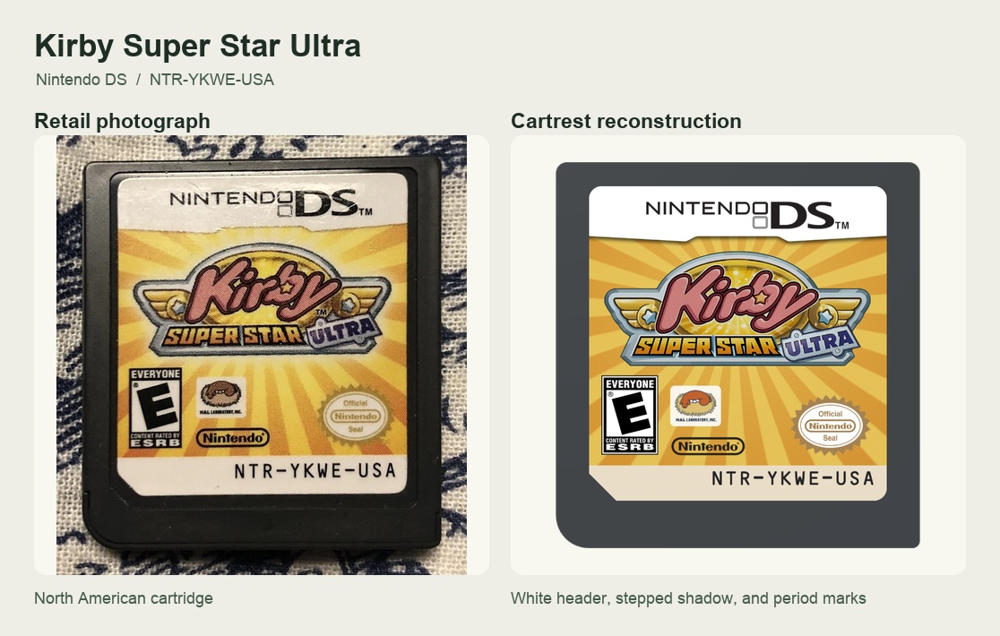
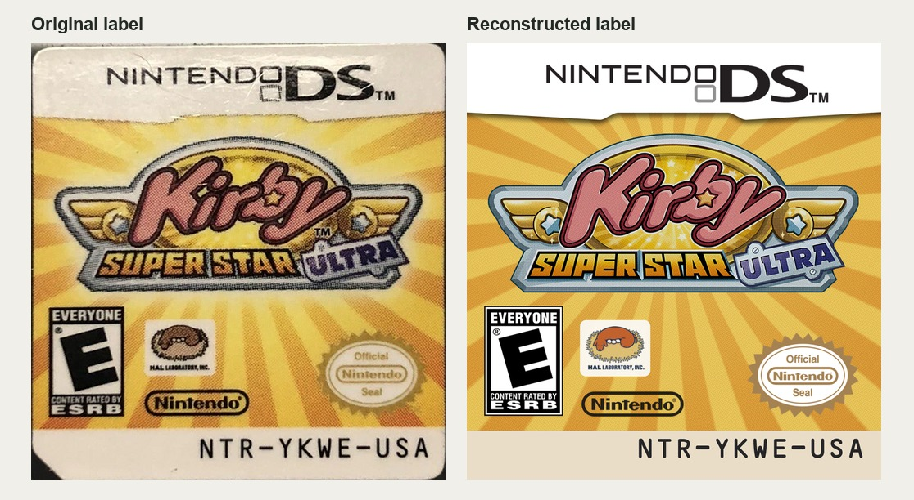

# Kirby Super Star Ultra cartridge study

This study rebuilds the North American Nintendo DS label `NTR-YKWE-USA` for the 100 mm Cartrest coaster. The reference is a photograph of the retail cartridge. The reconstruction uses Cartrest's Nintendo DS mesh and the finished sticker export. [Retail photograph by vibeg](https://www.ebay.com/itm/155754760339) · [Independent cartridge scan and code](https://vgcollect.com/item/10838)

## Rebuild the label

1. In **Nintendo DS**, set the coaster width to **100 mm**, bleed to **2 mm**, and resolution to **300 dpi**. Open **Label Designer**, import `background.png`, and use **Fill** at the starting zoom and position. [Background PNG](background.png)
2. Select **Nintendo DS · NTR** and **Shadow**. Set the band height to **91%** and logo size to about **109%**. Use white (`#FFFFFF`) for the band and `#E4D6BC` for the footer. Enter `NTR-YKWE-USA` with **Right** alignment and leave code size at its default.
3. Place the marks using the values below. Horizontal and vertical positions run from the top-left of the trim. Size is relative to the role's starting size.
4. Set noise to **5%**, grain to **0.20 mm**, and CMYK halftone to **13%** with **0.35 mm** dot spacing and a **45°** angle.
5. Use **Add to Sheet** or **Save PNG…**. For the finished artwork, open `label.png` with **Add images…** in **Coaster & Sheet**. The two-copy A4 sheet includes the trim, bleed, and 50 mm ruler. [Finished PNG](label.png) · [A4 print sheet](../../../print/kirby-super-star-ultra-reconstructed-a4.pdf)

| Slot | Graphic | Horizontal | Vertical | Size | Backing |
| --- | --- | ---: | ---: | ---: | ---: |
| Rating | E · Everyone (legacy) | 13.7% | 72.8% | 120% | None |
| Publisher | Nintendo · Black outline | 40% | 82.7% | 92% | None |
| Studio | HAL Laboratory · Inutamago | 35.8% | 69.9% | 72% | Light |
| Seal | Official Nintendo Seal | 82.3% | 76.1% | 140% | None |

## Comparison

The reconstruction uses a shallow white band with a shadow that follows its stepped edge, a warm footer, and stacked HAL and Nintendo marks. The product code uses OCR-B as specified in Nintendo's DS production drawing. [Nintendo DS production drawing](https://repo.mariocube.com/Marketing/Nintendo%20Design%20Files/AIfiles/DS_L_Card_Label/DS_L_CardLabel.pdf) · [OCR-B credits](../../../design/labels/fonts/NOTICE.md)

The original sticker was perspective-normalized to an 800 × 845 pixel rectangle for comparison. In the crop, the original product code spans pixels 327–765 horizontally, and the reconstruction spans 332–763. The mean absolute RGB difference is **42.5** on a 0–255 scale across the central crop and **37.0** across the mark band. The lighting and wear visible in the photograph contribute to both values.

The remaining visible differences include the sheen of the gold ink, the fine printed dot pattern, and the rim on the molded shell. The demonstration uses the coaster mesh and a digital print proof.

## Artwork sources

- The title lockup comes from the transparent artwork archive. The sunburst was drawn from the rays visible around the title, including an estimated 24 light-dark repeats around the center. [LaunchBox game gallery](https://gamesdb.launchbox-app.com/games/images/10842-kirby-super-star-ultra)
- The marks come from the period ESRB design, HAL Laboratory's Inutamago artwork, the black outline adapted from the Nintendo wordmark, and the North American Official Nintendo Seal. [ESRB Everyone reference](https://commons.wikimedia.org/wiki/File:ESRB_Everyone.svg) · [HAL Laboratory artwork](https://www.hallab.co.jp/eng/company/symbol) · [Nintendo artwork](https://commons.wikimedia.org/wiki/File:Nintendo.svg) · [Official Nintendo Seal artwork](https://commons.wikimedia.org/wiki/File:Nintendo_Official_Seal.svg)
